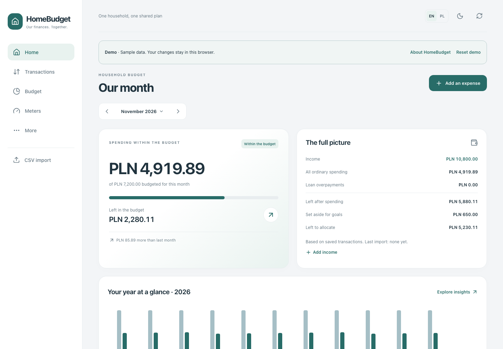
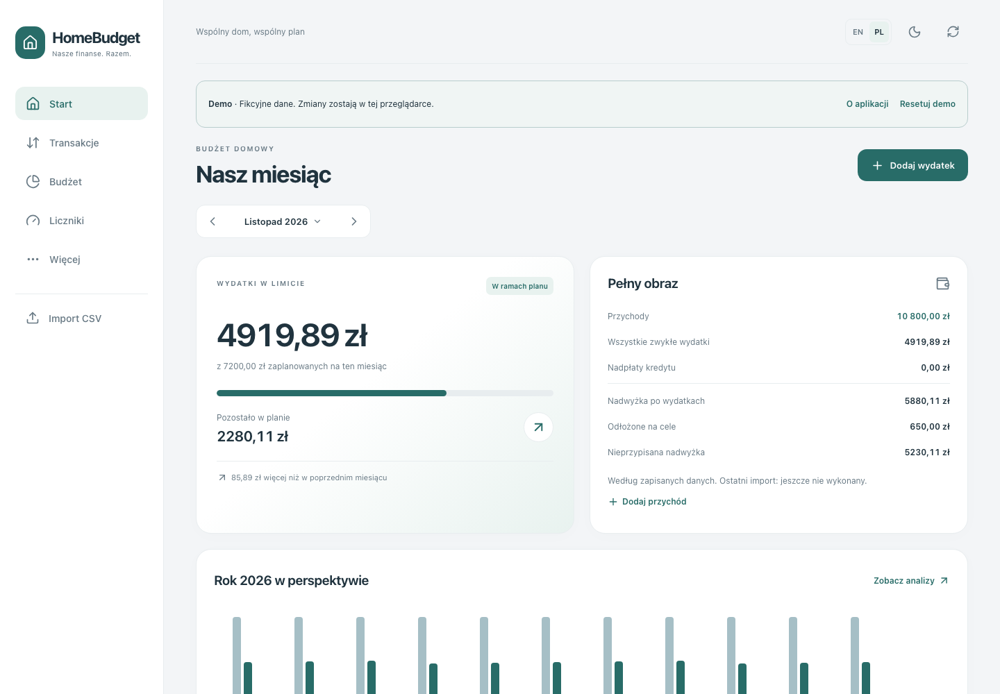

# HomeBudget

**English** · [Polski](README.pl.md)

[Polish website and demo](https://maciejdybowski.github.io/home-budget/) · [Polish README](README.pl.md)

A household budget you can run yourself. Keep your spending, bills and savings goals in one clear view, on your own computer or server.

**Built by [Maciej Dybowski](https://github.com/MaciejDybowski) · [MIT licence](LICENSE)**

[Explore the website](https://maciejdybowski.github.io/home-budget/en/) · [Try the live demo](https://maciejdybowski.github.io/home-budget/demo/?lang=en)

The website and demo become available after GitHub Pages is enabled and the publishing workflow completes.



 · [Mobile app](docs/screenshots/home-mobile.png)

## One household, one shared plan

- Record expenses, income and refunds. Set a monthly budget and optional category budgets.
- Import bank CSV files: match the columns, review suggestions and save a template for next time.
- Keep a shared store list. Rename stores, merge duplicates and carry the changes through your history.
- Explore spending by month, quarter, year or category. Open a total to see the transactions behind it.
- Plan subscriptions and recurring bills. Link them to actual expenses when you confirm a payment.
- Follow savings goals and record what you have really set aside.
- Track meter readings and estimated household usage.
- Use the app on a phone or desktop, in light or dark mode.

The interface, website and browser demo support **English and Polish**. The app follows your browser language initially; the EN/PL switch remembers your choice. Dates and amounts use the selected locale. Your own category names, notes and transaction descriptions stay as you entered them.

**Amounts are currently recorded in PLN.** Switching language does not convert money into another currency.

## Get started with Docker

You’ll need a running Docker installation with Compose v2, plus `curl` and `tar`. Use Linux, macOS, or Windows through WSL2/Docker Desktop. No local Node.js or database setup is required.

```sh
curl -fsSL https://github.com/MaciejDybowski/home-budget/releases/latest/download/install.sh | sh
```

The installer downloads a small deployment bundle and ready-made images from GitHub Container Registry. It generates a database password and starts the app. **Nothing is built on your machine.** Images support `linux/amd64` and `linux/arm64`.

Open **http://localhost:3001**. On a phone, use your computer or server’s network address and port `3001`.

Prefer to manage Compose yourself? Download `homebudget-compose.tar.gz` from [Releases](https://github.com/MaciejDybowski/home-budget/releases), unpack it, copy `env.example` to `.env` and set a random database password. Then run:

```sh
docker compose up -d
```

You can also run `sh install.sh` from the unpacked folder to create the configuration automatically. Keep `.env` and `pgdata/` when updating. Set the port with `FRONTEND_PORT` and choose an image version with `HOMEBUDGET_VERSION`.

Installation downloads become available once the first release and its public GHCR images are published.

### Try it first

The [browser demo](https://maciejdybowski.github.io/home-budget/demo/?lang=en) uses fictional records and saves changes only in your browser. Try adding an expense, changing a budget or merging stores. **Reset demo** brings the examples back. The import page uses a clearly labelled sample; full CSV reading and recognition rules are available in your own installation.

For a separate Docker installation with sample data, use `sh install.sh --demo`. This works only with an empty database. Use a separate, empty installation for your real finances.

## Your own space

HomeBudget currently provides one shared household workspace **without sign-in**. Keep your installation on a trusted home network or VPN. The public website and browser demo are separate from your real finances.

The app can be added to a phone’s home screen as a PWA. On iPhone, home-screen installation requires HTTPS with a trusted certificate.

Bank statements are processed by your own backend, not sent to an external classification service. The website uses locally hosted fonts and no trackers.

## Project notes

Frontend: Vue 3, TypeScript and Vite. Backend: NestJS, Prisma and PostgreSQL. Docker starts a new database automatically and applies future schema updates before the backend starts.

Detailed engineering and hosting notes are currently in Polish:

- [Installation and updates](docs/deployment.md)
- [Backups and recovery](docs/backups.md)
- [Database setup](docs/database.md)
- [User guide and CSV import](docs/user-guide.md)
- [Development and tests](docs/development.md)
- [Architecture](docs/architecture.md)
- [Website and browser demo](docs/pages.md)
- [Publishing a release](docs/publication.md)
- [Contributing](CONTRIBUTING.md)

## Licence

HomeBudget is free for personal and commercial use under [MIT](LICENSE). When sharing copies, keep the author credit and licence text. Dependencies and bundled fonts retain their own licences.
