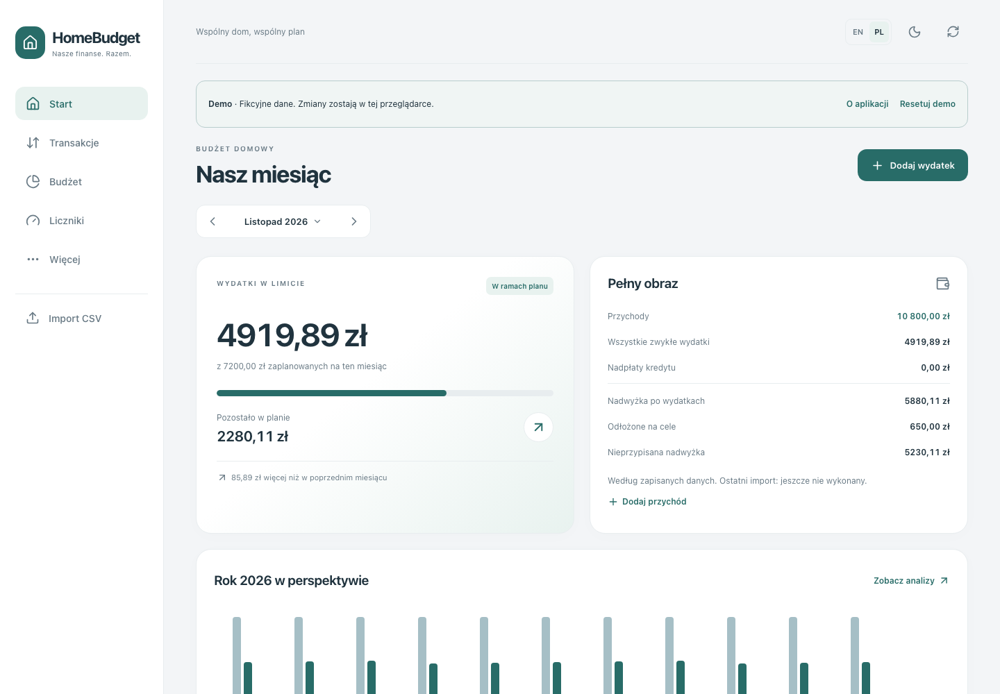

# HomeBudget

[English](README.md) · **Polski**

Domowy budżet, który możesz uruchomić u siebie. Mobilna aplikacja PWA z importem CSV, analizami wydatków, katalogiem sklepów, celami oszczędnościowymi i opłatami cyklicznymi.

Interfejs i demo działają po polsku oraz angielsku. Język możesz zmienić w nagłówku; aplikacja zapamięta Twój wybór. Zmiana języka nie przelicza waluty ani nie zmienia własnych nazw i opisów.

**Autor: [Maciej Dybowski](https://github.com/MaciejDybowski) · [MIT](LICENSE)**

[Strona prezentacyjna](https://maciejdybowski.github.io/home-budget/) · [Interaktywne demo](https://maciejdybowski.github.io/home-budget/demo/) — publikowane przez GitHub Pages po jego włączeniu.

[Website and demo in English](https://maciejdybowski.github.io/home-budget/en/) · [README in English](README.md)

Bezpłatna do użytku prywatnego i komercyjnego. Przy udostępnianiu kopii zachowaj informację o autorze i treść licencji. Zależności mają własne licencje.



[Widok telefonu](docs/screenshots/home-mobile.png) · [Analizy](docs/screenshots/analytics-desktop.png) · [English screenshot](docs/screenshots/home-desktop-en.png). Wszystkie pokazane dane są fikcyjne.

## Instalacja jednym poleceniem

Wymagane: uruchomiony Docker z Docker Compose v2, `curl` i `tar`. Linux, macOS lub Windows przez WSL2/Docker Desktop. Nie potrzebujesz kodu aplikacji, Node.js ani lokalnego budowania obrazów.

```sh
curl -fsSL https://github.com/MaciejDybowski/home-budget/releases/latest/download/install.sh | sh
```

Instalator pobiera małą paczkę wdrożeniową do `./homebudget`, generuje losowe hasło bazy, pobiera gotowe obrazy z **GitHub Container Registry (GHCR)** i uruchamia aplikację oraz migracje. Obrazy są dostępne dla `linux/amd64` i `linux/arm64`. Nie wymaga logowania do publicznych pakietów. Otwórz **http://localhost:3001**. Z telefonu użyj adresu komputera/serwera i portu `3001`.

Opcjonalnie od razu z **fikcyjnymi danymi demonstracyjnymi**:

```sh
curl -fsSL https://github.com/MaciejDybowski/home-budget/releases/latest/download/install.sh | sh -s -- --demo
```

Demo działa wyłącznie na pustej bazie. Zawiera trzy miesiące przykładowych finansów, sklepy, budżet, cel, licznik i subskrypcję. Do własnych finansów użyj osobnej, pustej instalacji.

### Sam Docker Compose

Pobierz `homebudget-compose.tar.gz` z [Releases](https://github.com/MaciejDybowski/home-budget/releases), rozpakuj, skopiuj `env.example` do `.env` i ustaw losowe hasło bazy. Następnie:

```sh
docker compose up -d
```

Możesz też uruchomić `sh install.sh` w rozpakowanym katalogu — wtedy konfiguracja powstanie automatycznie. Adres/port ustawisz w `.env` (`FRONTEND_BIND`, `FRONTEND_PORT`), a wersję obrazów w `HOMEBUDGET_VERSION`. Instalator nie nadpisuje istniejącego `.env` ani danych bazy. Dane są w `pgdata/` — zachowaj cały katalog instalacji. Oba warianty **wyłącznie pobierają obrazy**, bez `build`.

Polecenia instalacyjne będą dostępne po opublikowaniu pierwszego wydania i publicznych obrazów GHCR.

> To jedna wspólna przestrzeń domowa. Od wersji **2026.11.1** wybierasz [logowanie loginem i hasłem](docs/authentication.md) (`--auth`) albo tryb bez logowania (`--no-auth`, wyłącznie zaufany LAN/VPN). Nowa instalacja pyta o wybór; aktualizacja nie nadpisuje konfiguracji. Publiczna instancja wymaga logowania i HTTPS. Instalacja jako PWA na iPhone wymaga HTTPS z zaufanym certyfikatem.

## Możliwości

- Wydatki, przychody, zwroty, limity miesięczne i limity kategorii.
- Import CSV z mapowaniem kolumn, zapisanymi szablonami, wykrywaniem duplikatów i wycofaniem importu.
- Globalny katalog sklepów: uczenie rozpoznawania, zmiana nazw, scalanie i usuwanie.
- Analizy miesiąca, kwartału i roku; wykresy i transakcje tworzące sumę kategorii.
- Subskrypcje i stałe opłaty z potwierdzanym powiązaniem do faktycznych wydatków.
- Cele oszczędnościowe oraz liczniki zużycia.
- Jasny i ciemny motyw, interfejs dopasowany do telefonu.
- Bez zewnętrznych usług analizujących wyciągi. Obecnie kwoty w PLN.

## Dokumentacja

- [Instrukcja użytkownika i import CSV](docs/user-guide.md)
- [Instalacja, konfiguracja i aktualizacje](docs/deployment.md)
- [Backup i odtwarzanie](docs/backups.md)
- [Automatyczna inicjalizacja bazy](docs/database.md)
- [Rozwój i testy](docs/development.md)
- [Architektura](docs/architecture.md)
- [Udział w rozwoju](CONTRIBUTING.md)
- [Przygotowanie wydania](docs/publication.md)
- [Strona i przeglądarkowe demo](docs/pages.md)

Frontend: Vue 3, TypeScript, Vite. Backend: NestJS, Prisma, PostgreSQL. Kod aplikacji i ogólna dokumentacja są niezależne od infrastruktury konkretnej instalacji.
